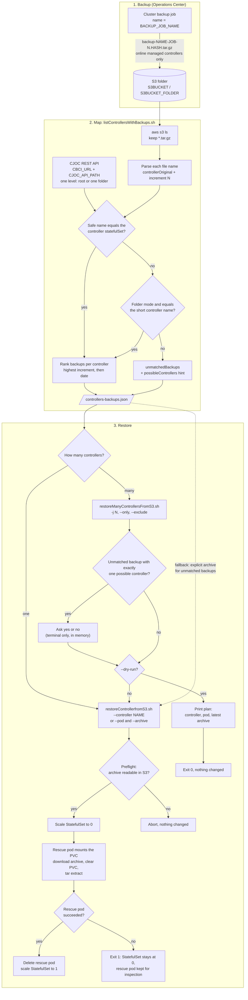
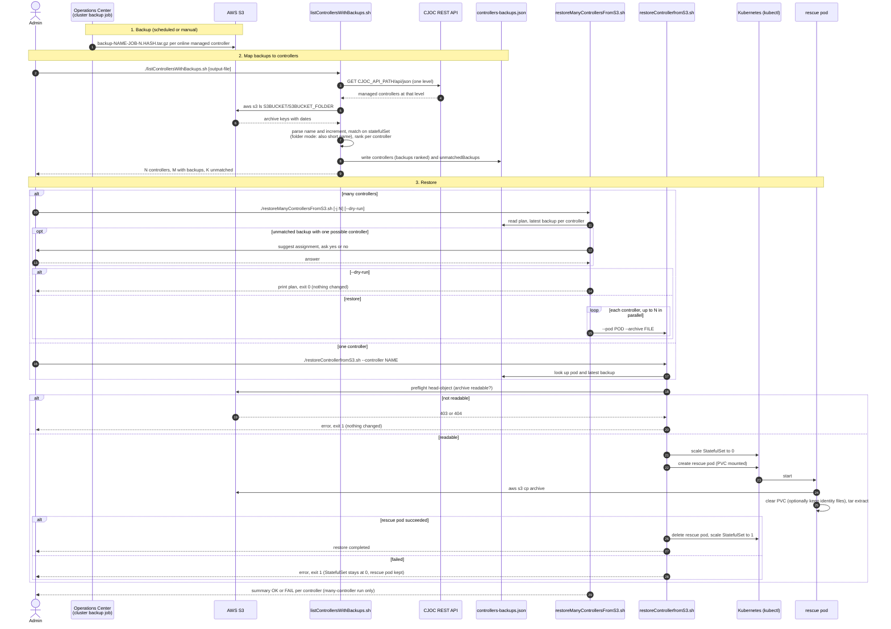

# End-to-End Diagrams

Overview of the whole backup-to-restore workflow. The per-script details (options, safety checks, unmatched-backup dialog) are in the sequence diagrams of the [README](README.md#script-reference).

Names such as `controller1`, `folder-dev1-controllers` or `cluster-op-backups` are placeholders.

## Flow

## Sequence

