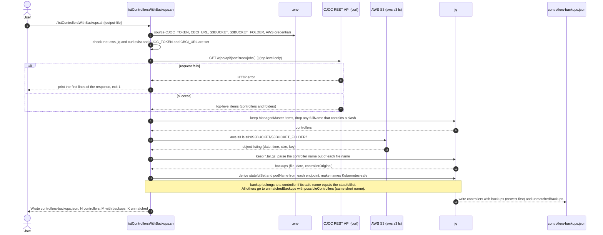
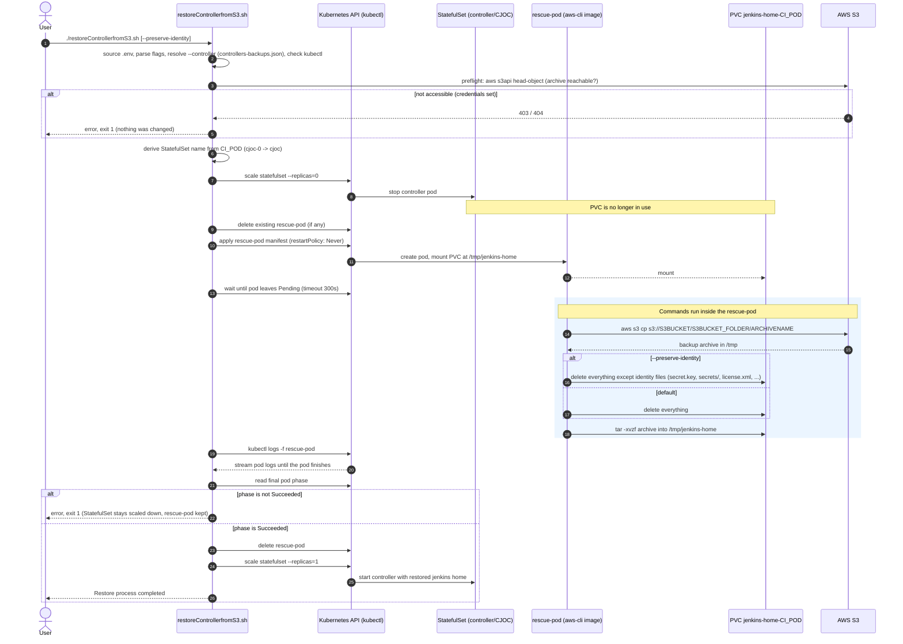
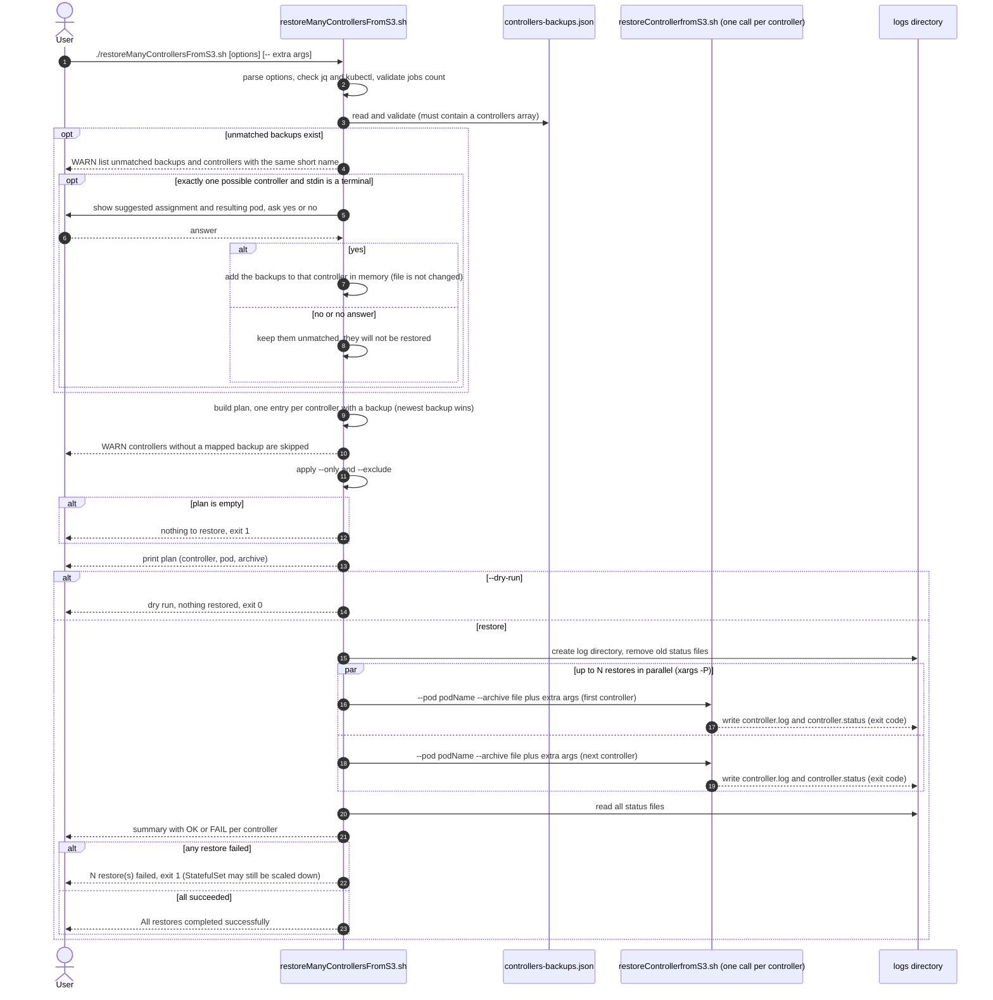

# CloudBees CI Backup and Restore Scripts

This repository provides a set of scripts and tools for restoring CloudBees CI on a Kubernetes environment (like AWS EKS) using AWS S3 for storage (JENKINS_HOME). The repository is a proof of concept and not recommended for production usage without further adjustments and reviews.

## Table of Contents

* [Overview](#overview)
* [Repository Contents](#repository-contents)
* [Quick Start](#quick-start)
* [Requirements](#requirements)
* [Setup and Configuration](#setup-and-configuration)
* [Concepts: Mapping Backups to Controllers](#concepts-mapping-backups-to-controllers)
* [Script Reference](#script-reference)
* [Appendix: Manual Backup with backup.sh](#appendix-manual-backup-with-backupsh)

## Overview

There are three primary methods for handling backups with CloudBees CI:

1. **CloudBees Backup Plugin:** A fully supported and integrated plugin that automates backups. See [CloudBees Backup Plugin](https://docs.cloudbees.com/docs/cloudbees-ci/latest/backup-restore/cloudbees-backup-plugin).
2. **Custom Scripts:** A more hands-on, script-based approach that gives you granular control over the backup and restore process. This method is useful for disaster recovery scenarios, manual interventions, or when you need a customized workflow.
3. **CloudBees Cluster Backup Operation:** A job on Operations Center that backs up all or a subset of controllers. See [CloudBees Cluster backup Operation](https://docs.cloudbees.com/docs/cloudbees-ci/latest/backup-restore/backup-cluster).

**This repository focuses on the third approach.** The scripts assume that a cluster backup operation was used to create the backups of the controllers and store them in S3. The scripts restore controllers from those backups. Other approaches, like volume snapshots (for example EBS snapshots), are not covered.

Further CloudBees documentation:

* [Backup and restore](https://docs.cloudbees.com/docs/cloudbees-ci/latest/backup-restore/)
* [Backup and restore on Kubernetes](https://docs.cloudbees.com/docs/cloudbees-ci/latest/backup-restore/kubernetes)
* [Back up manually](https://docs.cloudbees.com/docs/cloudbees-ci/latest/backup-restore/backup-manually)
* [Restoring from the backup plugin](https://docs.cloudbees.com/docs/cloudbees-ci/latest/backup-restore/restoring-from-backup-plugin)

---

## Repository Contents

| File | Description |
| --- | --- |
| [cluster-op.backup-controllers.yaml](cluster-op.backup-controllers.yaml) | CasC definition of the Operations Center cluster backup job (`cluster-op-backup-controllers`) that creates the archives. Its name is part of every archive file name. |
| [listControllersWithBackups.sh](listControllersWithBackups.sh) | Combines the controller list from CJOC and the S3 backup list and maps each backup to its controller (`controllers-backups.json`). |
| [restoreControllerfromS3.sh](restoreControllerfromS3.sh) | The main script to restore one controller's `jenkins_home` from an S3 backup. |
| [restoreManyControllersFromS3.sh](restoreManyControllersFromS3.sh) | Reads `controllers-backups.json` and restores many controllers in parallel by calling `restoreControllerfromS3.sh` for each. |
| [.env.template](.env.template) | Template with comments for the `.env` file that the scripts source. Copy it to `.env` and fill in your values. `.env` is git-ignored. |
| [Dockerfile](Dockerfile), [dockerbuild.sh](dockerbuild.sh) | Optional: a custom Docker image with the tools the restore script needs (`aws-cli`, `kubectl`, `tar`) and a helper script to build it. |
| [backup.sh](backup.sh) | Simple script to back up a single controller's `jenkins_home` to an S3 bucket. See the [appendix](#appendix-manual-backup-with-backupsh). |

---

## Quick Start

1. **Back up** the controllers into the S3 folder with the cluster backup job (see [cluster-op.backup-controllers.yaml](cluster-op.backup-controllers.yaml)). Only archives named by that job are mapped to controllers automatically.
2. **Map** the backups to the controllers. This writes `controllers-backups.json`:

   ```bash
   ./listControllersWithBackups.sh
   ```

3. **Check the plan** (nothing is changed, it warns about controllers without a backup and about unmatched backups):

   ```bash
   ./restoreManyControllersFromS3.sh --dry-run
   ```

4. **Restore** one controller, or many in parallel:

   ```bash
   ./restoreControllerfromS3.sh --controller <name>
   ./restoreManyControllersFromS3.sh -j 3
   ```

---

## Requirements

* **AWS access:** an S3 bucket and the required IAM permissions/access keys. Alternatively, the scripts can use pod identity if the controller is running on EKS (or a cluster that supports pod identity).
* **Kubernetes access:** `kubectl` access to the cluster hosting the CloudBees CI controllers.
* **Controller states:**
  * Source controller (backup): must be running and connected to Operations Center.
  * Optional target controller (when restoring to a new controller): a new controller must be running and connected to Operations Center.
* **Operations Center access:** a CJOC user and API token (`CJOC_TOKEN`), only needed by `listControllersWithBackups.sh` to read the controller list.
* **Tooling image:** access to a Docker registry to pull the tools image (containing `aws-cli` etc.), or build it yourself, see [Build Custom Docker Image](#3-build-custom-docker-image-optional).

**Bandwidth:** the restore scripts do not download the backup files to a local machine. They run inside the cluster where the controllers are running.

---

## Setup and Configuration

Before using the scripts, set up your AWS environment, your local machine and, optionally, the custom Docker image.

### 1. AWS Setup

You need an S3 bucket to store the backups and an IAM user with the correct permissions to access it.

**For an advanced setup using EKS pod identity** see [Using IAM roles for Service Accounts (IRSA)](https://docs.aws.amazon.com/eks/latest/userguide/iam-roles-for-service-accounts.html) and the example <https://github.com/cb-ci/ci-gateway-api/blob/main/eks/eksctl/07-createS3BackupBucket.sh>.

#### a. Create S3 Bucket

Create a new S3 bucket in your desired AWS region.
*See: [AWS S3 - Creating a bucket](https://docs.aws.amazon.com/AmazonS3/latest/userguide/creating-bucket.html)*

#### b. Create IAM Policy

Create an IAM policy that grants access to your S3 bucket.

> In AWS Console: **IAM -> Policies -> Create policy**

Use the following JSON, replacing `YOURBUCKET` with your bucket name:

```json
{
    "Version": "2012-10-17",
    "Statement": [
        {
            "Effect": "Allow",
            "Action": [
                "s3:PutObject",
                "s3:GetObject",
                "s3:DeleteObject"
            ],
            "Resource": "arn:aws:s3:::YOURBUCKET/*"
        },
        {
            "Effect": "Allow",
            "Action": "s3:ListBucket",
            "Resource": "arn:aws:s3:::YOURBUCKET"
        }
    ]
}
```

#### c. Create IAM User and Attach Policy

1. Create a new IAM user.
2. Attach the policy you created in the previous step directly to this user.
3. Generate an access key for this user and note the **Access Key ID** and **Secret Access Key**.

### 2. Local Environment

#### a. Required Tools

Ensure you have the following command-line tools installed and configured:

* `kubectl`: configured to connect to your Kubernetes cluster.
* `aws-cli`: configured for access to your AWS account.
* `jq`: needed by `listControllersWithBackups.sh`, `restoreControllerfromS3.sh` (for `--controller`) and `restoreManyControllersFromS3.sh`.
* `curl`: needed by `listControllersWithBackups.sh` to query CJOC.

#### b. Environment Variables

The scripts source a `.env` file from their own directory (`restoreManyControllersFromS3.sh` uses the one of the scripts it calls). Create it from the template and fill in your values. Every variable is documented with a comment in the template.

```bash
cp .env.template .env
```

**Do not commit `.env`**, it contains credentials. It is already listed in `.gitignore`.

| Variable | Needed by | Purpose |
| --- | --- | --- |
| `S3BUCKET`, `S3BUCKET_FOLDER` | all scripts | Bucket and folder with the backup archives. They must match `bucketName` / `bucketFolder` of the cluster backup job. |
| `CJOC_TOKEN`, `CBCI_URL` | `listControllersWithBackups.sh` | Operations Center credentials (`<user>:<api-token>`) and base URL. |
| `KUBECONFIG` | restore scripts | Cluster and namespace used by `kubectl`. |
| `AWS_ACCESS_KEY_ID`, `AWS_SECRET_ACCESS_KEY` | all scripts | AWS credentials. Leave unset when the pod uses pod identity. |
| `AWS_SESSION_TOKEN` | all scripts | Only for temporary credentials (SSO / assumed role, access keys starting with `ASIA`). |
| `CI_POD`, `ARCHIVENAME` | restore scripts, `backup.sh` | Target pod and archive. Optional for the restore scripts when `--controller`, `--pod` or `--archive` is used. |
| `PRESERVE_IDENTITY` | `restoreControllerfromS3.sh` | `true` keeps the target controller's identity files, same as `--preserve-identity`. |

> **Security note:** `restoreControllerfromS3.sh` passes the AWS credentials from `.env` into the rescue-pod spec as plain environment values, so anyone who can read the pod spec (`kubectl get pod -o yaml`) can read them. If your cluster supports pod identity (for example IRSA / EKS Pod Identity), leave `AWS_ACCESS_KEY_ID` unset: the script then adds no credentials to the pod spec and the pod uses its identity. Use least-privilege credentials with the IAM policy above either way.

### 3. Build Custom Docker Image (OPTIONAL)

[restoreControllerfromS3.sh](restoreControllerfromS3.sh) uses a custom Docker image (see [Dockerfile](Dockerfile)) that contains all the necessary tools. You can skip this step and use the one pushed here: <https://hub.docker.com/repository/docker/caternberg/aws-cli/general>

To build it yourself:

```bash
./dockerbuild.sh
```

This builds the `Dockerfile` and tags the image as `caternberg/aws-cli:1.X`. If your Kubernetes cluster does not have local access to the image, push it to a Docker registry (Docker Hub, ECR, GCR, ...) and update the image name in `restoreControllerfromS3.sh`.

---

## Concepts: Mapping Backups to Controllers

This section is the single place that explains how an archive in S3 is tied to a controller. The scripts in the [Script Reference](#script-reference) rely on it.

### Where the archives come from

The archives `backup-<controller>-cluster-op-backup-controllers-<n>.<hash>.tar.gz` are created by the CloudBees CI **cluster backup operation**. It runs from Operations Center as an item of type *Cluster Operations* with a *Backup Controller* step, which can back up all controllers or a subset, and needs the CloudBees Backup plugin on Operations Center. See [Back up a cluster](https://docs.cloudbees.com/docs/cloudbees-ci/latest/backup-restore/backup-cluster).

**The `cluster-op-backup-controllers` part of the file name is the name of that backup job.** The job in this repository is the CasC item [cluster-op.backup-controllers.yaml](cluster-op.backup-controllers.yaml) (`kind: clusterOpProject`, `name: cluster-op-backup-controllers`). If you create the job with another name, the archives are named after it and the `capture(...)` expression in `listControllersWithBackups.sh` must be changed to match.

<details>
<summary>Settings of the example job that matter for these scripts</summary>

| Setting in the YAML | Value in the example | Why it matters here |
| --- | --- | --- |
| `name` / `displayName` | `cluster-op-backup-controllers` | Becomes the middle part of the archive file name. |
| `store.s3Store.bucketName` | `<your-bucket>` | Must be the bucket in `S3BUCKET` of `.env`. |
| `store.s3Store.bucketFolder` | `cjoc-root-controllers` | Must be the folder in `S3BUCKET_FOLDER` of `.env`. The scripts only list this one folder. |
| `store.s3Store.region`, `sse` | `us-east-1`, `true` | Region of the bucket, archives are encrypted at rest with S3 server-side encryption. |
| `format` | `tarGzFormat` | The archives are `.tar.gz`, which is what `restoreControllerfromS3.sh` extracts (`tar -xzf`). |
| `retentionPolicy` | `upToNRetentionPolicy`, `n: 3` | The job keeps only a limited number of backups, so `controllers-backups.json` normally lists only the most recent ones. Check the CloudBees documentation for the exact scope of the retention. |
| `operations[].filters` | `isMasterOnlineFilter`, `isManagedMasterFilter`, `matchingPath: '*'` | Only managed controllers that are **online** when the job runs get a backup. A controller that was offline has no archive and shows up with an empty `backups` list. |
| `inParallel`, `timeoutSeconds` | `10`, `300` | The job backs up up to 10 controllers at the same time. |
| `subjects` | `jobConfigurationSubject`, `systemConfigurationSubject` (`omitMasterKey: false`) | What is in the archive: job and system configuration, including the master key (treat the archives as secrets). Only these two subjects are declared, so data outside them (for example build records) may not be in the archive. `restoreControllerfromS3.sh` clears the PVC before extracting, so check what an archive contains (`tar -tzf <file>`) before restoring over a controller. |

The `<n>` and `<hash>` parts of the file name are not documented by CloudBees. In our bucket `<n>` increased between two runs of the job (15, then 16) and `<hash>` stayed the same for a given controller, but the scripts do not rely on either.

</details>

### How a file name is mapped to a controller

Only `listControllersWithBackups.sh` parses archive file names. The restore scripts never do: they take the archive from `controllers-backups.json` (or from `--archive` / `ARCHIVENAME`, used as given). `backup.sh` does not enforce any naming either, it names the archive exactly as `ARCHIVENAME`.

**1. Extract the name from the file name.** The script runs this `jq` expression on every `*.tar.gz` key of the S3 folder:

```jq
controllerOriginal: (.[3] | capture("^backup-(?<c>.+)-cluster-op-backup-controllers-").c? // null)
```

* The file name must start with `backup-`.
* The controller name is everything between that leading `backup-` and `-cluster-op-backup-controllers-`. The `.+` is greedy, so a controller name may itself contain dashes and dots.
* The expression is not anchored at the end: whatever follows (for example `16.<hash>` and `.tar.gz`) is not interpreted.
* If the file name does not match, `controllerOriginal` is `null` and the archive can never be mapped.

**2. Normalize and compare.** The extracted name is made Kubernetes-safe (lowercase, every character outside `a-z`, `0-9` and `-`, such as `.` or `_`, becomes `-`, leading and trailing `-` are stripped) and compared with the controller's `statefulSet`. That is the last path segment of the controller's `endpoint`, and the pod is `<statefulSet>-0`. A backup belongs to a controller when both are equal. Everything else goes to `unmatchedBackups`.

| Archive file name | `controllerOriginal` | Normalized | Result |
| --- | --- | --- | --- |
| `backup-controller1-cluster-op-backup-controllers-16.<hash>.tar.gz` | `controller1` | `controller1` | mapped to `controller1` |
| `backup-controller-upgradetest-1-2.568.3.37913-cluster-op-backup-controllers-16.<hash>.tar.gz` | `controller-upgradetest-1-2.568.3.37913` | `controller-upgradetest-1-2-568-3-37913` | mapped to the controller whose `statefulSet` is that name |
| `backup-controllerinfolder-cluster-op-backup-controllers-15.<hash>.tar.gz` | `controllerinfolder` | `controllerinfolder` | unmatched (the controller is in a folder, so it is not listed) |
| `backup-mypod-12-03-2025.tar.gz` (typical `backup.sh` name) | `null` | | unmatched (no `-cluster-op-backup-controllers-` part) |

**Controllers in folders** are intentionally left out: only controllers directly under the Operations Center root are listed, so a controller below a folder or subfolder (its `fullName` contains a `/`) is never included. Their backups are reported in `unmatchedBackups` with an empty `possibleControllers`.

### Unmatched backups

Archives that match no controller land in `unmatchedBackups`. `possibleControllers` lists listed controllers with the same short name, as a hint only: `controllers-backups.json` never assigns them. You have three options:

* Name the job `cluster-op-backup-controllers`, or replace that text in the `capture(...)` expression of `listControllersWithBackups.sh` with your job name (for archives from a job with another name, `backup.sh` or another backup tool).
* Let `restoreManyControllersFromS3.sh` offer the assignment interactively, see [restoreManyControllersFromS3.sh](#restoremanycontrollersfroms3sh).
* Restore explicitly: `restoreControllerfromS3.sh --pod <statefulSet>-0 --archive <file>`.

---

## Script Reference

### listControllersWithBackups.sh

Reads the top-level controllers from CJOC, lists all `*.tar.gz` archives in `s3://$S3BUCKET/$S3BUCKET_FOLDER/` (values from `.env`, subfolders are not listed) and maps each backup to a controller using the [mapping rules](#concepts-mapping-backups-to-controllers). The result goes into one file:

```bash
./listControllersWithBackups.sh [output-file]   # default: controllers-backups.json
```

It needs `CJOC_TOKEN` and `CBCI_URL` in `.env` in addition to the S3 variables.

**Output format** (`date` is the object's last-modified time reported by S3):

```json
{
  "controllers": [
    {
      "name": "controller1",
      "fullName": "controller1",
      "statefulSet": "controller1",
      "podName": "controller1-0",
      "endpoint": "https://ci.example.com/controller1/",
      "state": "APPROVED",
      "online": true,
      "version": "2.580.1.38223",
      "backups": [
        { "file": "backup-controller1-cluster-op-backup-controllers-16.<hash>.tar.gz", "date": "2026-10-27 09:00:00" },
        { "file": "backup-controller1-cluster-op-backup-controllers-15.<hash>.tar.gz", "date": "2026-10-26 16:14:45" }
      ]
    }
  ],
  "unmatchedBackups": [
    {
      "file": "backup-controllerinfolder-cluster-op-backup-controllers-15.<hash>.tar.gz",
      "date": "2026-10-26 16:14:45",
      "controllerOriginal": "controllerinfolder",
      "possibleControllers": []
    }
  ]
}
```

`backups` is sorted newest first.

<details>
<summary>Sequence diagram</summary>



</details>

### restoreControllerfromS3.sh

Performs a full restore of one controller. It scales down the StatefulSet, creates a temporary "rescue pod" that downloads and extracts the backup onto the PVC, and then scales the StatefulSet back up.

**Usage:**

```bash
./restoreControllerfromS3.sh [--preserve-identity] [--controller NAME [--backups-file FILE]] [--pod CI_POD] [--archive ARCHIVENAME]

# example: restore a controller from its newest mapped backup
./restoreControllerfromS3.sh --controller controller1
```

Choose the target with `--controller` (recommended), with `--pod` / `--archive`, or with `CI_POD` / `ARCHIVENAME` in `.env`. To restore onto a new controller, point it at the new controller's pod.

**Options:**

| Option / variable | Description |
| --- | --- |
| `--controller NAME` | Looks up the pod and the newest backup of the controller in `controllers-backups.json`. `NAME` is the controller's `fullName`, its Kubernetes name, or a short name if it is unique. Fails if the controller is unknown, the name is ambiguous, or no backup is mapped to it. `--pod` / `--archive` still take precedence. |
| `--backups-file FILE` | JSON file used by `--controller` (default `controllers-backups.json`). |
| `--pod NAME` | Overrides `CI_POD` from `.env`. |
| `--archive FILE` | Overrides `ARCHIVENAME` from `.env`. |
| `--preserve-identity` (or `PRESERVE_IDENTITY=true` in `.env`) | Keep the target controller's identity files when the PVC is cleared: `secret.key`, `secrets/`, `license.xml`, `identity.key.enc`, `operations-center-cloud.xml`, `operations-center-client.xml` and `com.cloudbees.opscenter.client.plugin.OperationsCenterRootAction.xml`. The flag overrides `.env`. Default: everything is deleted. |
| `-h`, `--help` | Print usage. |
| `NO_COLOR=1` | Disable colored output. |

With `--preserve-identity` the restored controller keeps the target's `secrets/`, not the ones from the backup. See [How to reconnect a client controller stuck on registration](https://docs.cloudbees.com/docs/cloudbees-ci-kb/latest/operations-center/how-to-reconnect-a-client-controller-stuck-on-registration) for when this is useful.

**Safety checks and failures:**

* **Preflight:** before anything is scaled down, the script checks that the archive exists and is readable in S3 (`aws s3api head-object` with the credentials from `.env`). With credentials set, a failure aborts the run without changing anything. Without `AWS_ACCESS_KEY_ID` (pod identity) the local check only warns.
* **Failure inside the rescue-pod:** the script exits 1 **without** scaling the StatefulSet back up (the PVC may be partially restored) and keeps the rescue-pod for inspection.
* **Other failures:** the script logs the failing line and exits. If that happens after scale-down, the StatefulSet stays at 0 replicas and you must scale it back up manually (`kubectl scale statefulset/<name> --replicas=1`). If the rescue-pod was kept, remove it first (`kubectl delete pod rescue-pod-<statefulset>`).

**Output:** `[INFO]`, `[SUCCESS]`, `[WARN]` and `[ERROR]` messages (colored when run in a terminal).

**Tip:** consider avoiding that jobs start automatically on the target controller, either by

* [Preparing the controller for a quiet restart](https://docs.cloudbees.com/docs/cloudbees-ci/latest/cloud-admin-guide/quiet-start), or
* [disabling jobs](https://docs.cloudbees.com/docs/cloudbees-ci-kb/latest/client-and-managed-controllers/how-to-disable-all-jobs-in-a-specific-folder) (Jenkins init script).

<details>
<summary>Sequence diagram</summary>



</details>

### restoreManyControllersFromS3.sh

Reads `controllers-backups.json` and runs `restoreControllerfromS3.sh` once per controller, several in parallel.

**Usage:**

```bash
./restoreManyControllersFromS3.sh [-j N] [--only A,B] [--exclude A,B] [--dry-run] [--log-dir DIR] [-f FILE] [-- <extra restoreControllerfromS3.sh args>]

# example: 4 in parallel, skip one controller, keep identity files
./restoreManyControllersFromS3.sh -j 4 --exclude workshop -- --preserve-identity

# example: use another mapping file (-f) instead of the default controllers-backups.json,
# e.g. one written by "./listControllersWithBackups.sh my-backups.json" or a copy you trimmed by hand
./restoreManyControllersFromS3.sh -f my-backups.json --dry-run
./restoreManyControllersFromS3.sh -f my-backups.json -j 2
```

**Behavior:**

* The pod for each controller is its `podName` from the file (`<statefulSet>-0`). If a controller has several backups, the newest one (by `date`) is used. Controllers without a mapped backup are skipped with a warning.
* `-f FILE` selects another file (default `controllers-backups.json`). The old flat `backups.json` format is no longer read.
* `-j N` (or the `JOBS` env var) sets the number of parallel restores. Default: 3.
* `--only` / `--exclude` take comma-separated controller names, either the `fullName` or the Kubernetes name.
* `--dry-run` prints the controller → pod → archive plan and exits without touching the cluster. Use it first.
* Each restore logs to `logs/<statefulSet>.log`. A summary lists OK/FAIL per controller, and the script exits 1 if any restore failed. A failed controller's StatefulSet may stay scaled down, see [restoreControllerfromS3.sh](#restorecontrollerfroms3sh).
* Everything after `--` is passed to every `restoreControllerfromS3.sh` call. All restores use the same `.env` (credentials, `KUBECONFIG`).

**Unmatched backups:** they are listed with a warning, including the controller with the same short name (see [Unmatched backups](#unmatched-backups)). If exactly one listed controller has that short name, which happens only when the name in the file name differs from the controller's Kubernetes name, the script shows the suggested assignment with the resulting pod and asks `(yes/no)`:

* `yes`: the backups are added to that controller in memory and it is included in the restore plan (newest backup). `controllers-backups.json` is not changed.
* `no` (or no answer): unmatched backups are **not** restored.
* The question is asked only in a terminal (also with `--dry-run`, so you can preview the plan). Without a terminal the script only warns. Backups with several possible controllers are never suggested.

<details>
<summary>Sequence diagram</summary>



</details>

---

## Appendix: Manual Backup with backup.sh

`backup.sh` is a simple alternative to the cluster backup job for a **single** controller. It creates a compressed tarball of the controller's `jenkins_home` and uploads it to S3.

* **Naming:** the archive is named exactly as `ARCHIVENAME`. Such archives do not follow the [cluster backup naming](#how-a-file-name-is-mapped-to-a-controller), so they are not mapped to controllers automatically and show up in `unmatchedBackups`.
* **Configuration:** set `CI_POD` (the source controller's pod) and `ARCHIVENAME` in the env file the script sources. Note that `backup.sh` still sources `./set-env.sh` (the old file name, whose template was removed). Until it is switched to `.env`, create a `set-env.sh` with the same variables, or change the `source` line in `backup.sh`.
* **Space:** the tar archive is stored temporarily in the pod's `/tmp` directory before it is uploaded to S3. Ensure that `/tmp` has sufficient capacity, or mount a dedicated RWX NFS (or other persistent) volume for the backup.
* **Bandwidth:** the archive is copied through your local machine before it goes to S3, which is slow for large backups. Run the script and the S3 copy from an EC2 VM inside the same AWS VPC/subnet for maximum speed.

**Usage:**

```bash
./backup.sh
```
