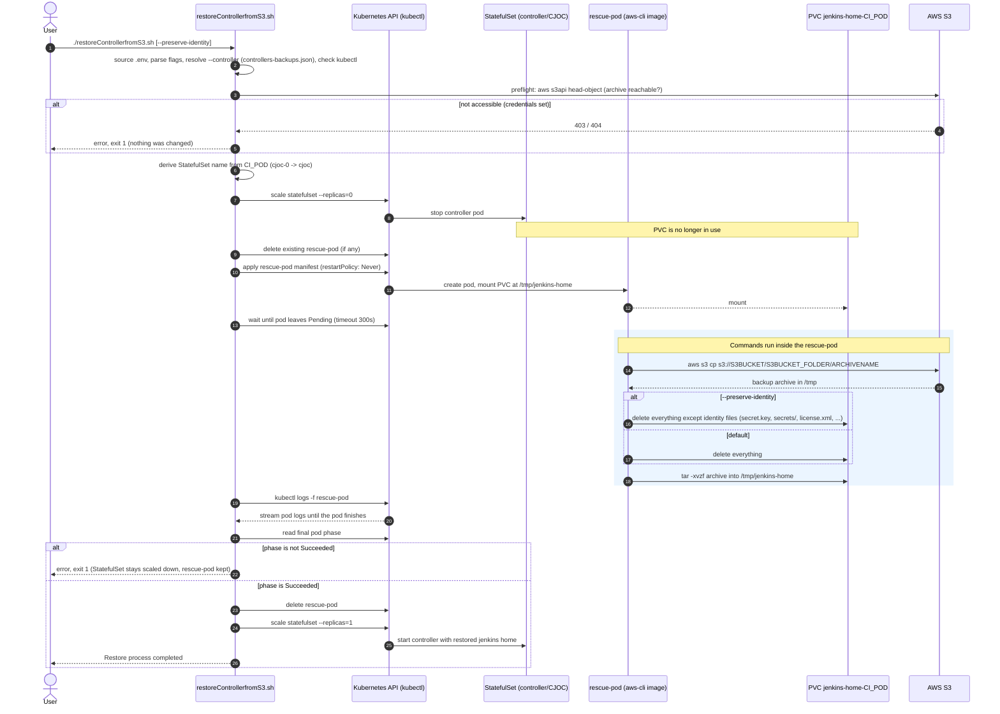
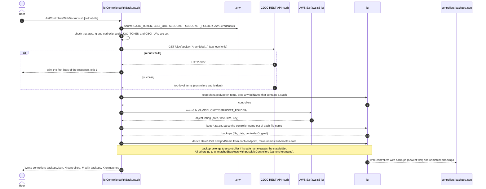
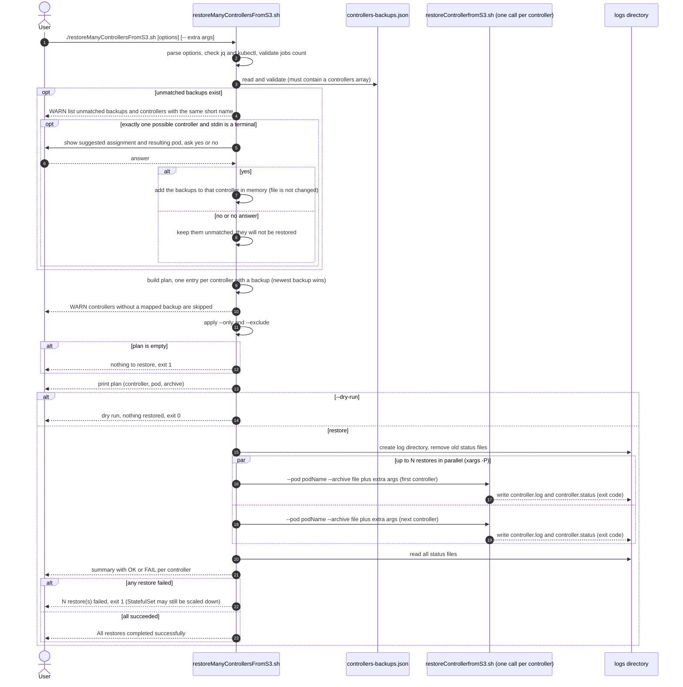

# CloudBees CI Backup and Restore Scripts

This repository provides a set of scripts and tools for backing up and restoring CloudBees CI on a Kubernetes environment (like AWS EKS) using AWS S3 for storage.

## Overview

There are two primary methods for handling backups with CloudBees CI:

1. **CloudBees Backup Plugin:** A fully supported and integrated plugin that automates backups. See the official documentation for more details:
    * [CloudBees Backup Plugin](https://docs.cloudbees.com/docs/cloudbees-ci/latest/backup-restore/cloudbees-backup-plugin)

2. **Custom Scripts (This Repository):** A more hands-on, script-based approach that gives you granular control over the backup and restore process. This method is useful for disaster recovery scenarios, manual interventions, or when you need a customized workflow.

This repository focuses on the second approach.

See CloudBees documentation for background:

* <https://docs.cloudbees.com/docs/cloudbees-ci/latest/backup-restore/cloudbees-backup-plugin>
* <https://docs.cloudbees.com/docs/cloudbees-ci/latest/backup-restore/>
* <https://docs.cloudbees.com/docs/cloudbees-ci/latest/backup-restore/kubernetes>
* <https://docs.cloudbees.com/docs/cloudbees-ci/latest/backup-restore/backup-cluster>
* <https://docs.cloudbees.com/docs/cloudbees-ci/latest/backup-restore/backup-manually>
* <https://docs.cloudbees.com/docs/cloudbees-ci/latest/backup-restore/restoring-from-backup-plugin>

---

## Repository Contents

This table explains the purpose of each file in this repository.

| File                                         | Description                                                                                                                          |
|----------------------------------------------|--------------------------------------------------------------------------------------------------------------------------------------|
| [backup.sh](backup.sh)                       | The main script to back up a controller's `jenkins_home` to an S3 bucket.                                                            |
| [restoreControllerfromS3.sh](restoreControllerfromS3.sh) | The main script to restore a controller's `jenkins_home` from an S3 backup.                                                          |
| [listControllersWithBackups.sh](listControllersWithBackups.sh) | Combines the controller list from CJOC and the S3 backup list and maps each backup to its controller (`controllers-backups.json`). |
| [restoreManyControllersFromS3.sh](restoreManyControllersFromS3.sh) | Reads `controllers-backups.json` and restores many controllers in parallel by calling `restoreControllerfromS3.sh` for each. |
| [.env.template](.env.template)               | Template for the `.env` file sourced by `restoreControllerfromS3.sh`. Copy it to `.env` and fill in your values. `.env` is git-ignored.   |
| [Dockerfile](Dockerfile)                     | For optional usage: Defines a custom Docker image containing essential tools (`aws-cli`, `kubectl`, `tar`) for the scripts.          |
| [dockerbuild.sh](dockerbuild.sh)             | For optional usage: A helper script to build the custom Docker image defined in the `Dockerfile`.                                                        |
| [cluster-op.backup-controllers.yaml](cluster-op.backup-controllers.yaml) | CasC definition of the Operations Center cluster backup job (`cluster-op-backup-controllers`) that creates the archives `listControllersWithBackups.sh` maps. Its name is part of every archive file name. |

---

## Requirements

* AWS Access: S3 Bucket and required IAM permissions/access keys.
* Kubernetes Access: kubectl access to the cluster hosting the CloudBees CI Controllers.
* Controller States (Backup/Restore):
  * Source: The controller to be backed up must be running.
  * Target: A new controller must be running and connected to Operations Center.
* Operations Center access: a CJOC user and API token (`CJOC_TOKEN`), only needed by `listControllersWithBackups.sh` to read the controller list.
* Tooling: Access to a Docker registry to pull the necessary tools image (containing aws-cli, etc.).
* Optional: EC2 VM (bastion host) to ensure faster transfer speeds/throughput (same VPC/subnet recommended).

**Bandwidth Warning:**

* Copying large .tar files locally (your laptop) and back to S3 will be slow. I recommend running the [backup.sh](backup.sh) script and S3 copy operation directly from an EC2 VM inside the same AWS VPC/subnet for max speed.

## Setup and Configuration

Before using the scripts, you need to set up your AWS environment, local machine, and the custom Docker image.

### 1. AWS Setup

You need an S3 bucket to store the backups and an IAM User with the correct permissions to access it.

#### a. Create S3 Bucket

Create a new S3 bucket in your desired AWS region.
*See: [AWS S3 - Creating a bucket](https://docs.aws.amazon.com/AmazonS3/latest/userguide/creating-bucket.html)*

#### b. Create IAM Policy

Create an IAM policy that grants access to your S3 bucket.

> In AWS Console: **IAM -> Policies -> Create policy**

Use the following JSON, replacing `YOURBUCKET` with your bucket name:

```json
{
    "Version": "2012-10-17",
    "Statement": [
        {
            "Effect": "Allow",
            "Action": [
                "s3:PutObject",
                "s3:GetObject",
                "s3:DeleteObject"
            ],
            "Resource": "arn:aws:s3:::YOURBUCKET/*"
        },
        {
            "Effect": "Allow",
            "Action": "s3:ListBucket",
            "Resource": "arn:aws:s3:::YOURBUCKET"
        }
    ]
}
```

#### c. Create IAM User and Attach Policy

1. Create a new IAM User.
2. Attach the policy you created in the previous step directly to this user.
3. Generate an access key for this user and note the **Access Key ID** and **Secret Access Key**.

### 2. Local Environment

Your local machine, where you will run the scripts, needs the following:

#### a. Required Tools

Ensure you have the following command-line tools installed and configured:

* `kubectl`: Configured to connect to your Kubernetes cluster.
* `aws-cli`: Configured for access to your AWS account.
* `jq`: Needed by `listControllersWithBackups.sh`, `restoreControllerfromS3.sh` (for `--controller`) and `restoreManyControllersFromS3.sh`.
* `curl`: Needed by `listControllersWithBackups.sh` to query CJOC.

#### b. Environment Variables

The scripts require several environment variables to be set. `restoreControllerfromS3.sh` and `listControllersWithBackups.sh` source a `.env` file from their own directory (`restoreManyControllersFromS3.sh` uses the one of the scripts it calls).

**Create a `.env` file from the template:**

```bash
cp .env.template .env
```

**Important:** Do not commit `.env` to version control, it contains credentials. It is already listed in `.gitignore`.

> **Note:** `backup.sh` still sources `./set-env.sh` (the old file name, whose template was removed). Until it is switched to `.env`, create a `set-env.sh` with the same variables for backups, or change the `source` line in `backup.sh`.

### 3. Build Custom Docker Image (OPTIONAL)

The [restoreControllerfromS3.sh](restoreControllerfromS3.sh) script uses a custom Docker image (See [Dockerfile](Dockerfile)) that contains all the necessary tools.
You can skip this step and use the one I have pushed here <https://hub.docker.com/repository/docker/caternberg/aws-cli/general>

#### a. Build the Image

Optional: Build the image by running the `dockerbuild.sh` script:

```bash
./dockerbuild.sh
```

This script builds the `Dockerfile` and tags the image as `caternberg/aws-cli:1.X`.

#### b. Push to a Registry

If your Kubernetes cluster does not have local access to the image, you will need to push it to a Docker registry (like Docker Hub, ECR, or GCR) and update the image name in the `restoreControllerfromS3.sh` script accordingly.

---

## Usage

### Typical Workflow

1. **Back up** controllers into the S3 folder with the cluster backup job (see [cluster-op.backup-controllers.yaml](cluster-op.backup-controllers.yaml)), the CloudBees Backup plugin, or `backup.sh`. Only archives named by the cluster backup job are mapped to controllers automatically.
2. **Map** the backups to the controllers: `./listControllersWithBackups.sh` writes `controllers-backups.json`.
3. **Check the plan:** `./restoreManyControllersFromS3.sh --dry-run` shows controller → pod → archive and warns about controllers without a backup and about unmatched backups.
4. **Restore** one controller with `./restoreControllerfromS3.sh --controller <name>`, or many in parallel with `./restoreManyControllersFromS3.sh -j 3`.

### Adjust Env Variables

In `.env`set the variables:

```
# The name of the CloudBees CI pod (e.g., cjoc-0 or my-controller-0).
# Optional for the restore scripts when --controller (or --pod) is used.
CI_POD="POD_NAME"
# The name of the S3 bucket where the backup is stored. 
S3BUCKET="YOUR_S3_BUCKET"
# The folder path within the S3 bucket. 
S3BUCKET_FOLDER="YOUR_S3_BACKUP_FOLDER"
# The filename of the backup archive.
# Optional for the restore scripts when --controller (or --archive) is used.
ARCHIVENAME="YOUR_BACKUP_ARCHIVE_NAME" # for example backup-mypod-12-03-2025.tar.gz

# Only for listControllersWithBackups.sh: Operations Center URL and credentials.
CJOC_TOKEN="<user>:<api-token>"
CBCI_URL="https://<your-ci-host>"

# Kubernetes Config
export KUBECONFIG="/path/to/your/kubeconfig"

export AWS_ACCESS_KEY_ID="..."
export AWS_SECRET_ACCESS_KEY="..."
# Only for temporary credentials (SSO / assumed role, access keys starting with 'ASIA'):
# export AWS_SESSION_TOKEN="..."

# Optional: keep the target controller's identity files on restore (see --preserve-identity)
# PRESERVE_IDENTITY=true
```

> **Security note:** `restoreControllerfromS3.sh` passes these AWS credentials into the rescue-pod spec as plain environment values, so anyone who can read the pod spec (`kubectl get pod -o yaml`) can read them. If your cluster supports pod identity (e.g. IRSA / EKS Pod Identity), leave `AWS_ACCESS_KEY_ID` unset: the script then adds no credentials to the pod spec and the pod uses its identity. Use least-privilege credentials with the IAM policy above either way.

### Backing Up a Controller

The `backup.sh` script creates a compressed tarball of a controller's `jenkins_home` and uploads it to S3.
**IMPORTANT:** You **must** update the `CI_POD` variable in the env file sourced by the script

```
...
CI_POD="YOUR_SOURCE_CONTROLLER_POD"
ARCHIVENAME="YOUR_BACKUP_ARCHIVE_NAME" 

```

**NOTE:** This script stores the tar archive temporarily in the pod’s `/tmp` directory before uploading to S3.
Ensure that `/tmp` has sufficient capacity. Alternatively, you can mount a dedicated RWX NFS (or other persistent) volume for the backup

**Usage:**

```bash
./backup.sh
```

### Restoring a Controller

The `restoreControllerfromS3.sh` script performs a full restore of a controller. It scales down the statefulset, creates a temporary "rescue pod" to download and extract the backup onto the PVC, and then scales the statefulset back up.

**Restore sequence:**



If the restore fails inside the rescue-pod, the script exits 1 **without** scaling the StatefulSet back up (the PVC may be partially restored) and keeps the rescue-pod for inspection. Other failures log the failing line and exit; see the **Output** note below.

**IMPORTANT:** You **must** update the `CI_POD` variable in `.env` if you want to restore on a new controller

```
CI_POD="YOUR_TARGET_CONTROLLER_POD"
ARCHIVENAME="YOUR_BACKUP_ARCHIVE_NAME" 
```

**Tip:** Consider to avoid jobs automatically starting on the target Controller, either by

* [Prepare Controller for quite restart](https://docs.cloudbees.com/docs/cloudbees-ci/latest/cloud-admin-guide/quiet-start)
* or [Disabling Jobs](https://docs.cloudbees.com/docs/cloudbees-ci-kb/latest/client-and-managed-controllers/how-to-disable-all-jobs-in-a-specific-folder) (Jenkins init script)

**Usage:**

```bash
./restoreControllerfromS3.sh [--preserve-identity] [--controller NAME [--backups-file FILE]] [--pod CI_POD] [--archive ARCHIVENAME]

# example: restore a controller from its newest mapped backup
./restoreControllerfromS3.sh --controller controller1
```

Before anything is scaled down, the script checks that the archive exists and is readable in S3 (`aws s3api head-object` with the credentials from `.env`). With credentials set, a failure aborts the run without changing anything. Without `AWS_ACCESS_KEY_ID` (pod identity) the local check only warns.

**Options:**

| Option / variable                                | Description                                                                                                                                                                                                                                    |
|--------------------------------------------------|------------------------------------------------------------------------------------------------------------------------------------------------------------------------------------------------------------------------------------------------|
| `--preserve-identity` (or `PRESERVE_IDENTITY=true` in `.env`) | Keep the target controller's identity files when the PVC is cleared: `secret.key`, `secrets/`, `license.xml`, `identity.key.enc`, `operations-center-cloud.xml`, `operations-center-client.xml` and `com.cloudbees.opscenter.client.plugin.OperationsCenterRootAction.xml`. The flag overrides `.env`. Default: everything is deleted. |
| `--controller NAME`                              | Looks up the pod and the newest backup of the controller in `controllers-backups.json` (see "Mapping Backups to Controllers"). `NAME` is the controller's `fullName`, its Kubernetes name, or a short name if it is unique. Fails if the controller is unknown, the name is ambiguous, or no backup is mapped to it. `--pod` / `--archive` still take precedence. |
| `--backups-file FILE`                            | JSON file used by `--controller` (default `controllers-backups.json`).                                                                                                                                                                         |
| `--pod NAME`                                     | Overrides `CI_POD` from `.env`.                                                                                                                                                                                                                |
| `--archive FILE`                                 | Overrides `ARCHIVENAME` from `.env`.                                                                                                                                                                                                           |
| `-h`, `--help`                                   | Print usage.                                                                                                                                                                                                                                   |
| `NO_COLOR=1`                                     | Disable colored output.                                                                                                                                                                                                                        |

With `--preserve-identity` the restored controller keeps the target's `secrets/`, not the ones from the backup. See [How to reconnect a client controller stuck on registration](https://docs.cloudbees.com/docs/cloudbees-ci-kb/latest/operations-center/how-to-reconnect-a-client-controller-stuck-on-registration) for when this is useful.

**Output:** the script prints `[INFO]`, `[SUCCESS]`, `[WARN]` and `[ERROR]` messages (colored when run in a terminal). On any failure it reports the failing line. If that happens after scale-down, the StatefulSet stays at 0 replicas and you must scale it back up manually (`kubectl scale statefulset/<name> --replicas=1`). If the rescue-pod was kept, remove it first (`kubectl delete pod rescue-pod-<statefulset>`).

### Mapping Backups to Controllers

`listControllersWithBackups.sh` first reads the top-level controllers from CJOC (controllers in folders and subfolders are **not** included), then lists all `*.tar.gz` archives in `s3://$S3BUCKET/$S3BUCKET_FOLDER/` (values from `.env`) and maps each backup to a controller. `date` is the object's last-modified time reported by S3. Only that S3 folder is listed, not its subfolders. The result goes into one file (default `controllers-backups.json`):

```bash
./listControllersWithBackups.sh [output-file]
```

It needs `CJOC_TOKEN=<user>:<api-token>` and `CBCI_URL=https://<host>` in `.env` in addition to the S3 variables.

**Mapping sequence:**



```json
{
  "controllers": [
    {
      "name": "controller1",
      "fullName": "controller1",
      "statefulSet": "controller1",
      "podName": "controller1-0",
      "endpoint": "https://ci.example.com/controller1/",
      "state": "APPROVED",
      "online": true,
      "version": "2.580.1.38223",
      "backups": [
        { "file": "backup-controller1-cluster-op-backup-controllers-16.<hash>.tar.gz", "date": "2026-10-27 09:00:00" },
        { "file": "backup-controller1-cluster-op-backup-controllers-15.<hash>.tar.gz", "date": "2026-10-26 16:14:45" }
      ]
    }
  ],
  "unmatchedBackups": [
    {
      "file": "backup-controllerinfolder-cluster-op-backup-controllers-15.<hash>.tar.gz",
      "date": "2026-10-26 16:14:45",
      "controllerOriginal": "controllerinfolder",
      "possibleControllers": []
    }
  ]
}
```

* Only controllers directly under the Operations Center root are listed. A controller below a folder or subfolder (its `fullName` contains a `/`) is never included; its backups end up in `unmatchedBackups`.
* `statefulSet` is the Kubernetes name: the last path segment of the controller's `endpoint`. `podName` is `<statefulSet>-0`.
* A backup is mapped to a controller when the name inside its file name (`backup-<name>-<job name>-<n>.<hash>.tar.gz`, where `<job name>` is `cluster-op-backup-controllers`, the name of the cluster backup job), made Kubernetes-safe (lowercase, every character outside `a-z`, `0-9` and `-`, such as `.`, becomes `-`), equals the controller's `statefulSet`. `backups` is sorted newest first.
* Archives that match no controller land in `unmatchedBackups`. `possibleControllers` lists controllers with the same short name. The file itself never assigns them; `restoreManyControllersFromS3.sh` can offer to do it interactively (see below).

> **Controllers in folders:** they are intentionally left out, so their backups (e.g. `backup-controllerinfolder-…`) are reported in `unmatchedBackups` with an empty `possibleControllers`. To restore one anyway use `restoreControllerfromS3.sh --pod <statefulSet>-0 --archive <file>`.

#### Where the archives come from: the cluster backup job

The `backup-<controller>-cluster-op-backup-controllers-<n>.<hash>.tar.gz` files that `listControllersWithBackups.sh` maps are created by the CloudBees CI **cluster backup operation**, not by `backup.sh`. It runs from Operations Center as an item of type *Cluster Operations* with a *Backup Controller* step, which can back up all controllers or a subset, and it needs the CloudBees Backup plugin on Operations Center. See [Back up a cluster](https://docs.cloudbees.com/docs/cloudbees-ci/latest/backup-restore/backup-cluster).

**The `cluster-op-backup-controllers` part of the file name is the name of that backup job.** The job in this repository is defined as a CasC item, [cluster-op.backup-controllers.yaml](cluster-op.backup-controllers.yaml) (`kind: clusterOpProject`, `name: cluster-op-backup-controllers`). If you create the job with another name, the archives are named after it and the `capture(...)` expression in `listControllersWithBackups.sh` must be changed to match (see below).

Settings of the example job that matter for these scripts:

| Setting in the YAML | Value in the example | Why it matters here |
|---|---|---|
| `name` / `displayName` | `cluster-op-backup-controllers` | Becomes the middle part of the archive file name. |
| `store.s3Store.bucketName` | `<your-bucket>` | Must be the bucket in `S3BUCKET` of `.env`. |
| `store.s3Store.bucketFolder` | `cjoc-root-controllers` | Must be the folder in `S3BUCKET_FOLDER` of `.env`. The scripts only list this one folder. |
| `store.s3Store.region`, `sse` | `us-east-1`, `true` | Region of the bucket, archives are encrypted at rest with S3 server-side encryption. |
| `format` | `tarGzFormat` | The archives are `.tar.gz`, which is what `restoreControllerfromS3.sh` extracts (`tar -xzf`). |
| `retentionPolicy` | `upToNRetentionPolicy`, `n: 3` | The job keeps only a limited number of backups, so `controllers-backups.json` normally lists only the most recent ones. Check the CloudBees documentation for the exact scope of the retention. |
| `operations[].filters` | `isMasterOnlineFilter`, `isManagedMasterFilter`, `matchingPath: '*'` | Only managed controllers that are **online** when the job runs get a backup. A controller that was offline has no archive and shows up with an empty `backups` list. |
| `inParallel`, `timeoutSeconds` | `10`, `300` | The job backs up up to 10 controllers at the same time. |
| `subjects` | `jobConfigurationSubject`, `systemConfigurationSubject` (`omitMasterKey: false`) | What is in the archive: job and system configuration, including the master key (treat the archives as secrets). Only these two subjects are declared, so data outside them (for example build records) may not be in the archive. `restoreControllerfromS3.sh` clears the PVC before extracting, so check what an archive contains (`tar -tzf <file>`) before restoring over a controller. |

The `<n>` and `<hash>` parts of the file name are not documented by CloudBees. In our bucket `<n>` increased between two runs of the job (15, then 16) and `<hash>` stayed the same for a given controller, but the scripts do not rely on either.

#### How archive file names are mapped to controllers

Only `listControllersWithBackups.sh` parses archive file names. The restore scripts never do: they take the archive from `controllers-backups.json` (or from `--archive` / `ARCHIVENAME`, used as given). `backup.sh` does not enforce any naming either, it names the archive exactly as `ARCHIVENAME`.

The mapping has two steps.

**1. Extract the name from the file name.** `listControllersWithBackups.sh` (the `BACKUPS` step) runs this `jq` expression on every `*.tar.gz` key of the S3 folder:

```jq
controllerOriginal: (.[3] | capture("^backup-(?<c>.+)-cluster-op-backup-controllers-").c? // null)
```

* The file name must start with `backup-`.
* The controller name is everything between that leading `backup-` and `-cluster-op-backup-controllers-`. The `.+` is greedy, so a controller name may itself contain dashes and dots.
* The expression is not anchored at the end: whatever follows `-cluster-op-backup-controllers-` (for example `16.<hash>` and `.tar.gz`) is not interpreted.
* If the file name does not match, `controllerOriginal` is `null` and the archive can never be mapped.

**2. Normalize and compare.** The extracted name is made Kubernetes-safe and compared with the controller's `statefulSet`, which is the last path segment of the controller's `endpoint`:

* lowercase the name, replace every character outside `a-z`, `0-9` and `-` (for example `.` or `_`) with `-`, and strip leading and trailing `-`;
* a backup belongs to a controller when the normalized name equals its `statefulSet`. Everything else goes to `unmatchedBackups`.

| Archive file name | `controllerOriginal` | Normalized | Result |
|---|---|---|---|
| `backup-controller1-cluster-op-backup-controllers-16.<hash>.tar.gz` | `controller1` | `controller1` | mapped to `controller1` |
| `backup-controller-upgradetest-1-2.568.3.37913-cluster-op-backup-controllers-16.<hash>.tar.gz` | `controller-upgradetest-1-2.568.3.37913` | `controller-upgradetest-1-2-568-3-37913` | mapped to the controller whose `statefulSet` is that name |
| `backup-controllerinfolder-cluster-op-backup-controllers-15.<hash>.tar.gz` | `controllerinfolder` | `controllerinfolder` | unmatched (the controller is in a folder, so it is not listed) |
| `backup-mypod-12-03-2025.tar.gz` (typical `backup.sh` name) | `null` | | unmatched (no `-cluster-op-backup-controllers-` part) |

> **If your archives are named differently** (a cluster backup job with another name, `backup.sh`, or another backup job), they will show up in `unmatchedBackups`. Either name the job `cluster-op-backup-controllers`, or replace `cluster-op-backup-controllers` in the `capture(...)` expression of `listControllersWithBackups.sh` with your job name, or restore them explicitly with `restoreControllerfromS3.sh --pod <statefulSet>-0 --archive <file>`.

### Restoring Many Controllers

`restoreManyControllersFromS3.sh` reads `controllers-backups.json` (see above) and runs `restoreControllerfromS3.sh` once per controller, several in parallel.

```bash
./restoreManyControllersFromS3.sh [-j N] [--only A,B] [--exclude A,B] [--dry-run] [--log-dir DIR] [-f FILE] [-- <extra restoreControllerfromS3.sh args>]

# example: 4 in parallel, skip one controller, keep identity files
./restoreManyControllersFromS3.sh -j 4 --exclude workshop -- --preserve-identity
```

**Many-restore sequence:**



* The pod for each controller is its `podName` from the file (`<statefulSet>-0`).
* If a controller has several backups, the newest one (by `date`) is used. Controllers without a mapped backup are skipped with a warning.
* **Unmatched backups:** they are listed with a warning, including the controller with the same short name. If exactly one listed controller has that short name (only when the name in the file name differs from the controller's Kubernetes name), the script shows the suggested assignment with the resulting pod and asks `(yes/no)`:
  * `yes`: the backups are added to that controller in memory and it is included in the restore plan (newest backup). `controllers-backups.json` is not changed.
  * `no` (or no answer): unmatched backups are **not** restored.
  * The question is asked only in a terminal (also with `--dry-run`, so you can preview the plan). Without a terminal the script only warns. Backups with several possible controllers are never suggested.
  * For anything left unmatched, use `restoreControllerfromS3.sh --controller <name> --archive <file>`.
* `-f FILE` selects another file (default `controllers-backups.json`). The old flat `backups.json` format is no longer read.
* `-j N` (or the `JOBS` env var) sets the number of parallel restores. Default: 3.
* `--only` / `--exclude` take comma-separated controller names, either the `fullName` or the Kubernetes name.
* `--dry-run` prints the controller → pod → archive plan and exits without touching the cluster. Use it first.
* Each restore logs to `logs/<statefulSet>.log`. A summary lists OK/FAIL per controller, and the script exits 1 if any restore failed.
* Everything after `--` is passed to every `restoreControllerfromS3.sh` call.
* All restores use the same `.env` (credentials, `KUBECONFIG`). A failed controller's StatefulSet may stay scaled down, see the note above.

---
